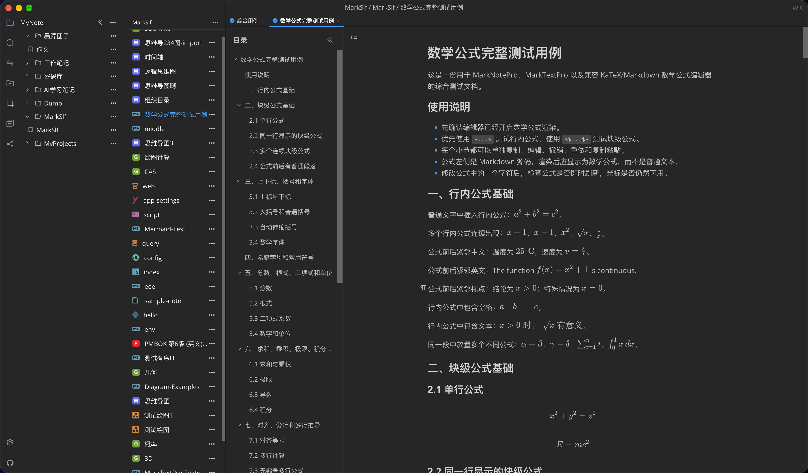
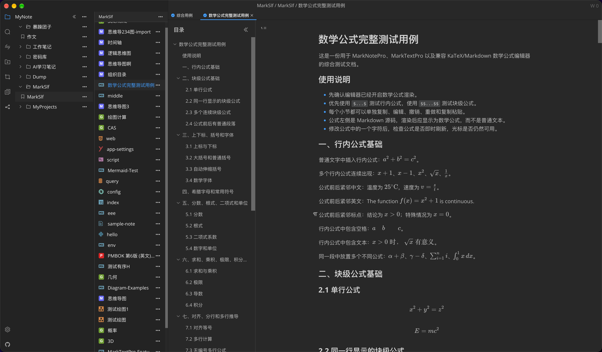
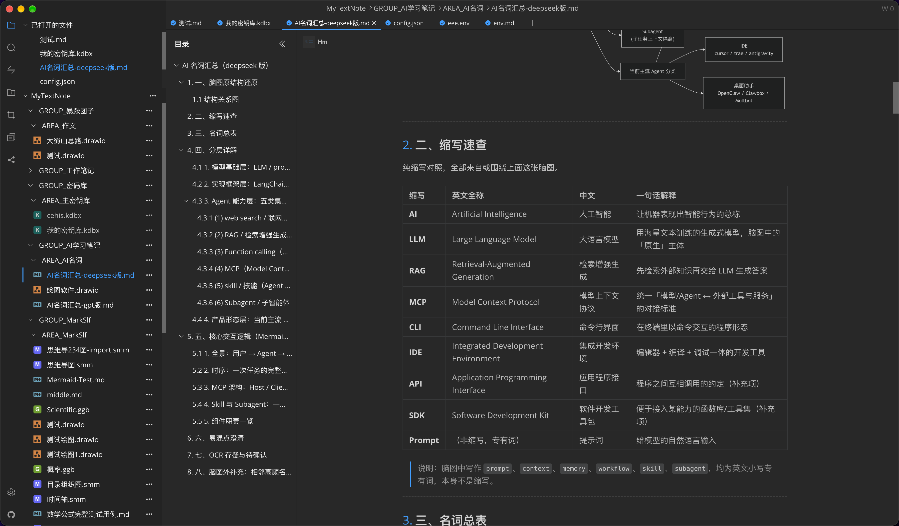
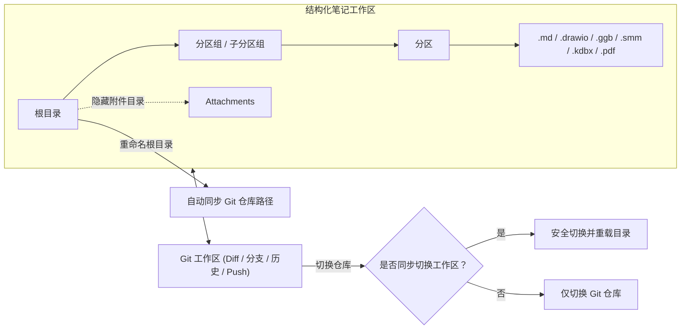

<p align="center"></p>

<h1 align="center">MarkNotePro</h1>

<div align="center">
  <strong>本地优先的结构化多模态知识与生产力工作台</strong><br>
  围绕分区层级组织长期知识库：原生集成 Markdown、Draw.io、GeoGebra、MindMap、PDF 专业批注、KDBX 密码库（2FA & SSH/SFTP 直连）、局域网共享与 Git 版本控制。<br>
  <sub>支持 Linux、macOS、Windows（核心创作与加密引擎 100% 离线可用）</sub>
</div>

<div align="center">
  <strong>简体中文</strong>
  <span> | </span>
  <a href="README_en.md">English</a>
</div>

<br>

<div align="center">
  <a href="LICENSE">
    
  </a>
  <a href="https://github.com/scott20201225/marknote-pro/releases">
    
  </a>
  <a href="https://github.com/scott20201225/marknote-pro/releases/latest">
    
  </a>
  <a href="https://gitee.com/cmflovekm/marknote-pro">
    
  </a>
</div>

<div align="center">
  <h4>
    <a href="#功能演示">功能演示</a>
    <span> · </span>
    <a href="#产品定位与双产品对比">产品对比</a>
    <span> · </span>
    <a href="#核心能力矩阵">核心能力</a>
    <span> · </span>
    <a href="#工作区与-git-联动">工作区与 Git</a>
    <span> · </span>
    <a href="#安全规范">安全规范</a>
    <span> · </span>
    <a href="#下载安装与源码构建">下载构建</a>
    <span> · </span>
    <a href="#开源协议与第三方声明">开源协议</a>
  </h4>
</div>

---

## 功能演示

一站式覆盖结构化笔记、Markdown 排版与增强表格、Draw.io 架构图、MindMap 脑图、Git 版本控制、GeoGebra 建模、KDBX 密码库（2FA/SSH）、多工作区无缝迁移、全局截屏贴图与剪贴板历史、局域网共享及 PDF 原地批注：

<p align="center">
  
</p>

## 产品定位与双产品对比

**MarkNotePro** 面向长期笔记与体系化知识沉淀：采用「工作区 → 分区组 → 分区 → 文档」层级组织知识，侧边栏只呈现受支持的标准目录与知识资产，避免工程杂项文件干扰。

同一项目目录在姊妹产品中的视图对比如下：

<table>
  <tr>
    <td align="center" width="50%">
      
      <br>
      <sub><b>MarkNotePro</b>：聚焦分区层级，自动过滤非笔记目录与杂项文件</sub>
    </td>
    <td align="center" width="50%">
      
      <br>
      <sub><b>MarkTextPro</b>：映射真实文件夹树，适合代码仓库与外部独立文档</sub>
    </td>
  </tr>
</table>

| 维度 | MarkNotePro（本仓库） | [MarkTextPro](https://github.com/scott20201225/marktext-pro)（姊妹项目） |
| --- | --- | --- |
| **组织模型** | 笔记工作区、分区组（支持子组）、分区与文档，支持 Tree / List 双视图 | 开放文件系统，完整展示真实目录，支持打开工作区外独立文件 |
| **适用场景** | 个人长期知识库、体系化笔记、团队研发文档、本地凭据与资料归档 | 代码仓库协作、项目文档编辑、自由文件夹与临时多模态文件处理 |
| **共同底座** | 共享同一套离线多模态引擎、KDBX/2FA/SSH 安全工作台、Git 集成与效率套件 | 同左 |
| **仓库与下载** | [GitHub Releases](https://github.com/scott20201225/marknote-pro/releases/latest) · [Gitee 镜像](https://gitee.com/cmflovekm/marknote-pro) | [GitHub Releases](https://github.com/scott20201225/marktext-pro/releases/latest) · [Gitee 镜像](https://gitee.com/cmflovekm/marktext-pro) |

## 核心能力矩阵

### 1. 内置创作与专业引擎（100% 离线可用）

所有文档均以开放通用格式保存于本地目录，跨设备通过 Git 无损同步，拒绝云端厂商锁定：

| 模块 / 格式 | 核心特性 | 导入导出与资源管理 |
| --- | --- | --- |
| **Markdown** (`.md`) | 所见即所得编辑；支持 LaTeX 数学公式、Mermaid 流程图/饼图、5 种 Callouts 警示块、快捷插入面板、任务批量编辑及强化表格工具 | 本地图片自动归档至 `Attachments/` 相对路径；表格支持与 Excel 互操作 |
| **Draw.io 绘图** (`.drawio`) | 完整离线 diagrams.net 引擎：架构图、流程图、UML、ER 图、网络拓扑，多标签保活切换与自动保存 | 支持导出 `PNG`、`JPEG`、`SVG`、`PDF`、`HTML`、`XML` |
| **GeoGebra 建模** (`.ggb`) | 内置官方全功能套件：绘图计算、几何作图、3D 计算器、CAS 符号代数、概率统计、科学计算器 6 大模式 | 图片内嵌于 `.ggb` 包；支持导出 `.ggb`、`.png`、`.svg`、`.pdf`、`.stl`（3D 打印）与打印 |
| **MindMap 脑图** (`.smm`) | 思维导图、逻辑图、目录/组织结构图、时间轴、鱼骨图 6 种结构；支持 LaTeX、贴纸、关联线、概要、外框、双向大纲编辑与快捷键面板 | 支持导入 `.xmind` / `.md` / `.smm` / `.json` / `.mind`（自动防重名创建并打开）；导出 `PNG`、`SVG`、`PDF`、`Markdown`、`JSON` 与打印 |
| **PDF 阅读批注** (`.pdf`) | 基于 Mozilla PDF.js：流式阅读、大纲缩略图、全文搜索、自适应缩放与明暗主题适配；提供高亮、下划线/删除线、手绘涂鸦、文字批注、图章与签名 | `Cmd+S / Ctrl+S` 原地静默覆盖保存（无冗余弹窗），修改状态双向实时同步 |
| **纯文本轻量编辑** | 原生支持 `.txt`、`.json` 等常见纯文本与配置文件的快速查看、轻量修改与原地保存 | 直接读写本地文件 |

### 2. KDBX 加密密码库、2FA 与 SSH/SFTP 安全工作台

基于 [KDBXWeb](https://github.com/keeweb/kdbxweb) 构建本地 KeePass 兼容（`.kdbx`）凭据库与运维终端栈：

- **加密凭据管理**：独立主密码加密，支持分组、条目、自定义字段、标签筛选、附件预览、历史记录、回收站、主密码重置及受提取码保护的批量导入导出。
- **TOTP 2FA 动态口令**：实时环形倒计时，支持扫码、**粘贴剪贴板截图 (`Cmd+V / Ctrl+V`)** 与 `otpauth://` / Base32 URI 批量导入去重；与终端交互防重放打通。
- **SSH / 终端直连与传输**：**安全前提——须先建立 `.kdbx` 密钥库并绑定条目凭据**，方可从条目一键打开独立终端标签页发起 SSH/Telnet 连接（支持自动填充凭据与 **2FA 自动验证**）；终端侧边抽屉内置图形化 **SFTP 文件管理器**，并原生支持 **ZMODEM (`rz / sz`)** 传输。

### 3. 局域网共享与桌面效率套件

- **局域网文件共享**：一键开启工作区或文件局域网共享，清晰划分**「我的分享」**与**「他人分享」**权限视图，无需第三方网盘即可在同网段设备间高速互传与预览。
- **多工作区切换与迁移**：支持工作区快速切换，以及在分支/工作区变动时提供**自动合并提示**与**手动合并对比**防呆保护。
- **全局截屏、贴图与剪贴板历史**：内置快捷键全局截屏、桌面置顶贴图（Pin）及本地剪贴板历史检索，写作与开发查错无缝衔接。
- **工作区内链互通**：侧边栏一键复制工作区相对路径或 Markdown 链接，在笔记内点击即可直达同库的其他文档、图表、脑图或 PDF 标签页。

## 工作区与 Git 联动

MarkNotePro 将 **Git 工作流**（基于 GitHub Desktop 核心理念）与**结构化笔记工作区**深度绑定，支持仓库克隆、Diff 审阅、分支管理、历史回溯及一键提交推送。



- **核心约束**：首用须选定本地工作区根目录；删除或移动分区/文档时，系统自动关闭或同步重定向已打开标签路径，避免脏写入。

## 安全规范

将 Git 作为个人知识与敏感凭据库同步底座时，请务必遵守以下规则：

1. **务必使用私有仓库（Private Repository）**：个人笔记、技术架构图、运维文档与业务规划严禁托管于公开 Git 仓库。
2. **严禁推送 `.kdbx` 至公有仓库**：虽有 AES-256 / ChaCha20 加密，公开暴露密码库仍面临离线暴力爆破风险；若仓库必须开源，请确保在 `.gitignore` 中排除 `*.kdbx` 或拆分为独立私有库。
3. **使用 16 位高强度主密码**：主密码决定 KDBX 抗爆破上限，建议设置满 16 位大小写字母与数字组合，避免弱口令或复用密码。

## 下载安装与源码构建


- **GitHub Releases 官方下载**：[https://github.com/scott20201225/marknote-pro/releases/latest](https://github.com/scott20201225/marknote-pro/releases/latest)
- **Gitee 国内镜像**：[https://gitee.com/cmflovekm/marknote-pro](https://gitee.com/cmflovekm/marknote-pro)
- **安装包命名**：macOS `marknotepro-mac-(arm64|x64)-%version%.dmg` · Windows `marknotepro-win-(x64|arm64)-%version%-setup.exe` · Linux `deb / rpm / snap / tar.gz`

```bash
# 本地开发调试
pnpm install
pnpm --filter marknotepro dev

# 打包桌面客户端
pnpm --filter marknotepro build
```

## 开源协议与第三方声明

本项目采用 **[MarkNotePro 非商业使用与商业授权许可协议](LICENSE)**：

- **非商业使用免费**：个人学习、教育演示、学术研究及个人文档管理可免费下载使用。
- **商业使用须获授权**：未经著作权人（[ScottCheng](https://github.com/scott20201225)）事先书面授权，严禁将本项目（含源码、安装包、衍生版本或内置模块）用于销售、SaaS/商业产品集成、企业商用部署或去除版权标识后分发。商业合作请联系作者。

<details>
<summary>第三方开源与集成组件声明（8 项）</summary>

- **draw.io (diagrams.net)**：[Apache License 2.0](https://www.apache.org/licenses/LICENSE-2.0) (`Copyright (c) 2005-present JGraph Ltd`)
- **GeoGebra**：[GeoGebra License](https://www.geogebra.org/license)（源码遵循 **GPLv3**；软件、文档与语言资产遵循 **GeoGebra Non-Commercial License Agreement / CC BY-NC-SA 3.0**，仅限非商业使用免费）
- **simple-mind-map**：[MIT License](https://github.com/wanglin2/mind-map/blob/main/LICENSE) (`Copyright (c) 2021-2023 The MindMap Team / wanglin2`)
- **KDBXWeb**：[MIT License](https://github.com/keeweb/kdbxweb/blob/master/LICENSE) (`Copyright (C) 2021-2025 Antelle`)
- **PDF.js**：[Apache License 2.0](https://www.apache.org/licenses/LICENSE-2.0) (`Copyright 2024 Mozilla Foundation`)
- **Tabby**：[MIT License](https://github.com/Eugeny/tabby/blob/master/LICENSE) (`Copyright (c) 2017-present Eugenia Kim (Eugeny)`)
- **GitHub Desktop**：MIT License (`Copyright (c) GitHub, Inc.`)
- **MarkText & Muya**：MIT License (`Copyright (c) 2017-present Luo Ran & MarkText Contributors`)

</details>
