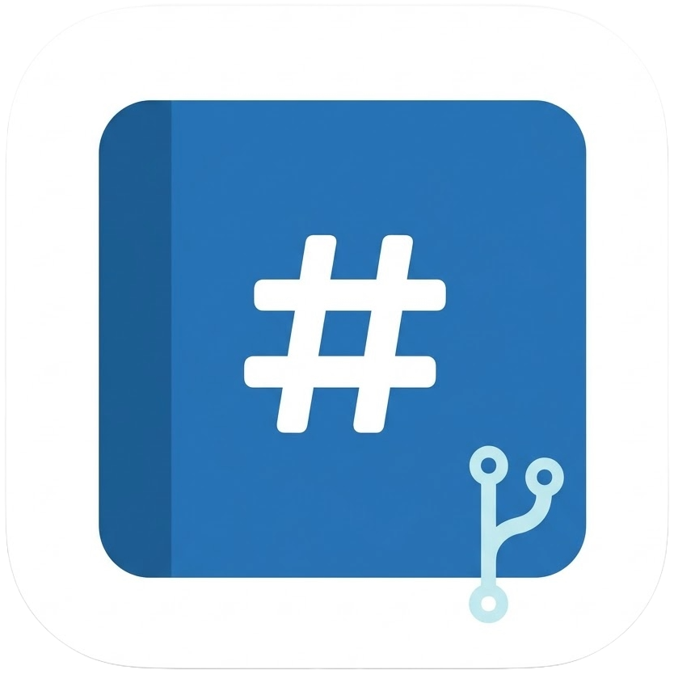
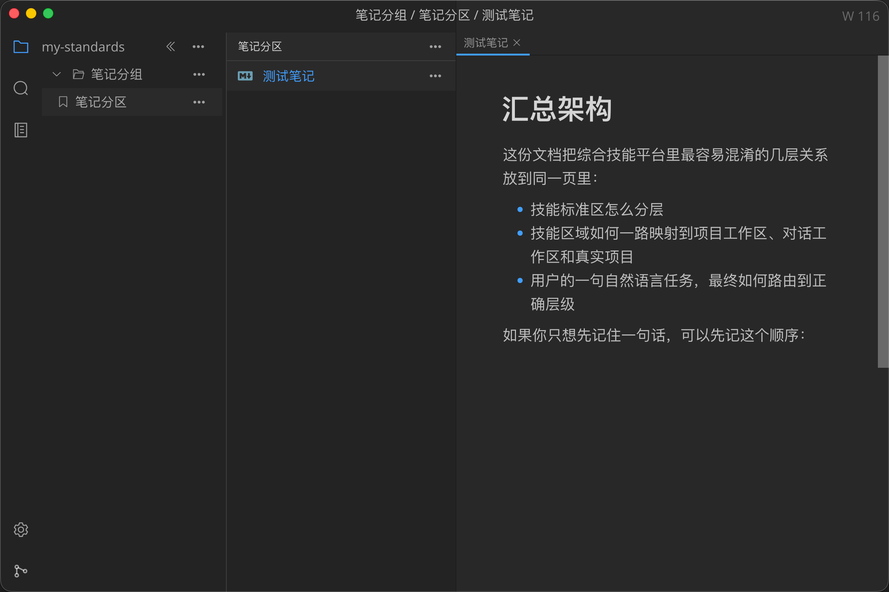
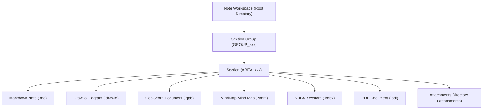
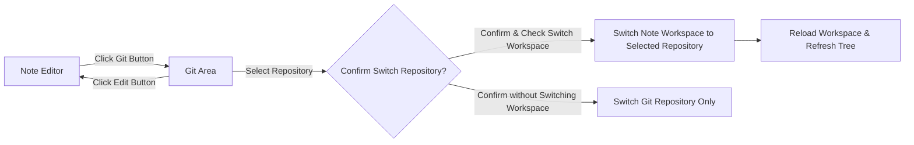
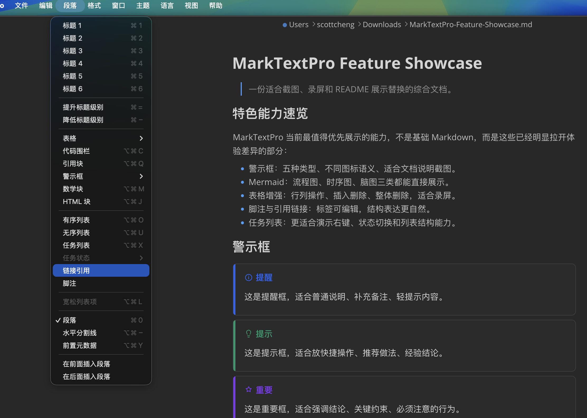
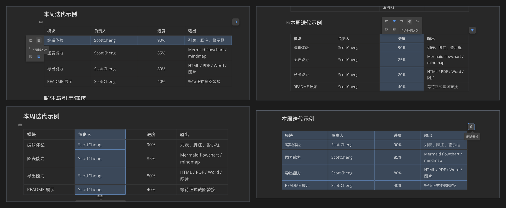
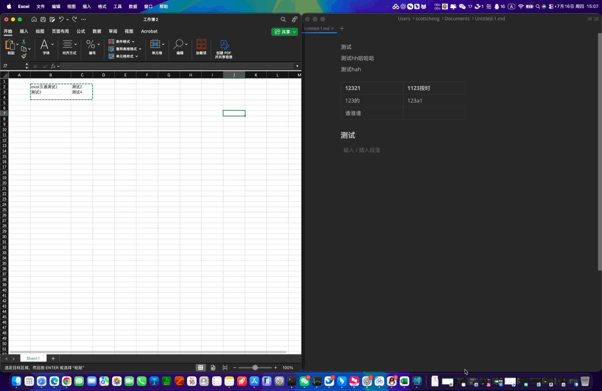

<p align="center"></p>

<h1 align="center">MarkNotePro</h1>

<div align="center">
  <strong>Local Markdown Notes & Knowledge Workbench with Git, Draw.io, GeoGebra, MindMap, KDBX Keystore (2FA & SSH) & PDF Annotation</strong><br>
  Manage knowledge bases in local directories with native support for Markdown notes, Draw.io professional diagrams, GeoGebra math modeling, MindMap mind maps, KDBX encrypted keystores, and PDF annotations, using Git for version control, syncing, and recovery.<br>
  <sub>Supports Linux, macOS, and Windows.</sub>
</div>

<div align="center">
  <a href="README.md">简体中文</a>
  <span> | </span>
  <strong>English</strong>
</div>

<br>

<div align="center">
  <a href="LICENSE">
    
  </a>
  <a href="https://github.com/scott20201225/marknote-pro/releases">
    
  </a>
  <a href="https://github.com/scott20201225/marknote-pro/releases/latest">
    
  </a>
  <a href="https://gitee.com/cmflovekm/marknote-pro">
    
  </a>
</div>

<div align="center">
  <h3>
    <a href="#product-positioning">Product Positioning</a>
    <span> | </span>
    <a href="#core-capabilities">Core Capabilities</a>
    <span> | </span>
    <a href="#built-in-creation--security-engines-drawio-geogebra-mindmap-kdbx--pdf">Built-in Engines</a>
    <span> | </span>
    <a href="#kdbx-encrypted-keystore">KDBX Keystore</a>
    <span> | </span>
    <a href="#product-selection">Product Selection</a>
    <span> | </span>
    <a href="#note-workspace-model">Workspace Model</a>
    <span> | </span>
    <a href="#git-integration">Git Integration</a>
    <span> | </span>
    <a href="#security--git-guidelines">Security Guidelines</a>
    <span> | </span>
    <a href="#screenshots--demos">Screenshots</a>
    <span> | </span>
    <a href="#download--installation">Download & Install</a>
  </h3>
</div>

## Product Positioning

MarkNotePro is a local-first structured knowledge management and multimodal creation workbench. Centered around structured note workspaces, it organizes documents via section groups and sections on the left, while natively integrating **Markdown**, **Draw.io architectural diagrams**, **GeoGebra mathematical modeling**, **MindMap mind mapping**, and **professional PDF reading & annotation** on the right, along with lightweight editing for plain text (`.txt`, `.json`, etc.). It also features a built-in **KDBX encrypted keystore with 2FA TOTP** and **SSH/terminal direct connection** (requiring keystore establishment, launching sessions directly via entries with automated 2FA verification), seamlessly coupled with Git for version control, commits, and remote synchronization.

Ideal for scenarios such as:

- Managing personal notes, technical architecture diagrams, mathematical/engineering derivations, mind maps, PDF research annotations, server credentials, and long-term knowledge bases within a single local directory.
- Using open, universal local file formats (`.md`, `.drawio`, `.ggb`, `.smm`, `.kdbx`, `.pdf`) to retain complete data ownership without vendor cloud lock-in.
- Creating and editing Draw.io diagrams, GeoGebra models, MindMaps, and annotating PDFs (highlighter, ink doodles, comments, stamps, signatures, in-place overwrite saving) directly in the workspace, 100% offline.
- Synchronizing knowledge repositories via GitHub, Gitee, GitLab, or self-hosted Git services across multiple computers with lossless version history, commits, and rollbacks.
- Maintaining clean, structured knowledge without clutter from unrelated project directories.

## Product Selection

MarkNotePro and MarkTextPro are two independent, complementary products:

- **MarkNotePro**: **Local structured note-taking & multimodal knowledge workbench**. Emphasizes note workspaces, section groups, sections, and structured document hierarchies. Natively integrates **Markdown, Draw.io, GeoGebra, MindMap, KDBX encrypted keystore (2FA TOTP & SSH direct connect), and PDF reading & annotation**, tailored for long-term notes, systematic knowledge bases, and local credential management.
- **MarkTextPro**: **Local free file & project multimodal workspace manager**. Emphasizes open file systems, arbitrary folder structures, standalone external files, and code project collaboration. Natively integrates **Markdown, Draw.io, GeoGebra, MindMap, KDBX encrypted keystore (2FA TOTP & SSH direct connect), and PDF reading & annotation**, tailored for code repositories, external tech docs, and flexible editing.

Related Addresses:

- **MarkNotePro** (Structured local notes & multimodal knowledge workbench):
  - GitHub Repository: [https://github.com/scott20201225/marknote-pro](https://github.com/scott20201225/marknote-pro)
  - Gitee Mirror (Recommended for China): [https://gitee.com/cmflovekm/marknote-pro](https://gitee.com/cmflovekm/marknote-pro)
  - Fast Mirror Download (Mainland China / No VPN): [https://ghfast.top/https://github.com/scott20201225/marknote-pro/releases/latest](https://ghfast.top/https://github.com/scott20201225/marknote-pro/releases/latest)
  - GitHub Official Releases: [https://github.com/scott20201225/marknote-pro/releases/latest](https://github.com/scott20201225/marknote-pro/releases/latest)
- **MarkTextPro** (Free file & project multimodal workspace):
  - GitHub Repository: [https://github.com/scott20201225/marktext-pro](https://github.com/scott20201225/marktext-pro)
  - Gitee Mirror (Recommended for China): [https://gitee.com/cmflovekm/marktext-pro](https://gitee.com/cmflovekm/marktext-pro)
  - Fast Mirror Download (Mainland China / No VPN): [https://ghfast.top/https://github.com/scott20201225/marktext-pro/releases/latest](https://ghfast.top/https://github.com/scott20201225/marktext-pro/releases/latest)
  - GitHub Official Releases: [https://github.com/scott20201225/marktext-pro/releases/latest](https://github.com/scott20201225/marktext-pro/releases/latest)

Both integrate a Git workspace for version management, remote synchronization, and multi-device collaboration. Your choice depends on whether you need a **"structured multimodal note workbench"** or a **"free multimodal project file manager"**.

Comparison of the same project displayed in both products: MarkNotePro only displays directories and documents conforming to note standards (`.md` / `.drawio` / `.ggb` / `.smm` / `.kdbx` / `.pdf`), converging them into Section Groups / Sections / Notes; MarkTextPro displays the full, authentic file system hierarchy.

<table>
  <tr>
    <td align="center">
      
      <br>
      <sub>MarkNotePro: Displays only structured note directories and knowledge documents</sub>
    </td>
    <td align="center">
      
      <br>
      <sub>MarkTextPro: Displays authentic, complete file system hierarchy</sub>
    </td>
  </tr>
</table>

Selection Guide:

| Use Case / Requirement | Recommended Product |
| --- | --- |
| You want to manage long-term notes, structured knowledge bases, and project materials like a notebook | MarkNotePro |
| You need to author Markdown, draw Draw.io architecture/flowcharts, build GeoGebra models, create MindMaps, or annotate PDFs within structured notes | MarkNotePro |
| You need to manage master-password-protected KDBX keystores, 2FA dynamic tokens, and direct SSH terminal sessions in structured workspaces | MarkNotePro |
| You prefer a notebook / section group / section / document hierarchical structure | MarkNotePro |
| You want the sidebar to display only note systems, eliminating clutter from unrelated project files | MarkNotePro |
| You primarily work within real folders, code repositories, or frequently edit standalone documents and project READMEs | MarkTextPro |
| You need to create and manage Markdown, Draw.io diagrams, GeoGebra models, MindMaps, KDBX keystores, or annotate PDFs directly within arbitrary folders or external paths | MarkTextPro |
| You prefer to retain real file system directory structures without notebook hierarchy constraints | MarkTextPro |
| You need a flexible local multimodal file and project workspace manager | MarkTextPro |

## Core Capabilities

- **Structured Knowledge Base Management**: Organize knowledge via Notebook Workspaces, Section Groups, and Sections; manage Markdown notes, Draw.io diagrams, GeoGebra math models, MindMaps, KDBX keystores, and PDF documents uniformly.
- **External Document Quick Editing**: Open standalone `.md`, `.drawio`, `.ggb`, `.smm`, `.kdbx`, `.pdf`, `.txt`, `.json` files outside the workspace for preview, editing, annotation, and management.
- **Lightweight Plain Text & Config Editing**: Natively open and edit common plain text and configuration files such as `.txt` and `.json` with in-place saving.
- **Multi-Tab & Multi-Type Cooperative Editing**: Open, switch smoothly among, and preserve active sessions for multiple Markdown notes, Draw.io diagrams, GeoGebra calculations, MindMaps, KDBX keystores, text files, and PDF annotations simultaneously.
- **Built-in Professional PDF Reading & Annotation Engine**: Offline integration of Mozilla PDF.js full-featured engine with streaming reading, outline navigation, thumbnails, multi-language full-text search, page rotation, and adaptive scaling; comprehensive annotation tools including **text highlighting** (multi-color and opacity control), **underline/strikethrough**, **freehand drawing (Ink)**, **text comments**, **image/stamp insertion**, and **digital signatures**; in-place file overwrite via `Cmd+S / Ctrl+S` without popup prompts, precise dirty-state tracking, and dark/light theme adaptation.
- **Built-in Draw.io Professional Diagram Engine**: Offline integration of the complete Draw.io editor for creating, editing, and auto-saving `.drawio` files, with export support for PNG, JPEG, SVG, PDF, HTML, XML, etc.
- **Built-in GeoGebra Mathematical & Geometric Suite**: Offline integration of the official GeoGebra engine supporting six modes: **Graphing**, **Geometry**, **3D Calculator**, **CAS (Computer Algebra System)**, **Probability**, and **Scientific Calculator**, with export to `.ggb`, `.png`, `.svg`, `.pdf`, `.stl` (3D printing), and direct printing.
- **Built-in MindMap Professional Mind Mapping Engine**: Offline integration of a full-featured mind mapping workbench supporting 6 classic structures: **Mind Map**, **Logical Structure**, **Organization Structure**, **Catalog Organization**, **Timeline**, and **Fishbone Diagram**; supports rich-text nodes, LaTeX math formulas, node icons/stickers, hyperlinks, associative lines, summary nodes, outer frames, notes, and tags; outline view sync, import of XMind / Markdown / .smm, and export to PNG, SVG, PDF, Markdown, JSON, and system printing.
- **Built-in KDBX Encrypted Keystore (with 2FA & SSH Direct Connect)**: KeePass-compatible `.kdbx` keystores built on KDBXWeb; supports groups, entries, custom fields, tags, attachments, history, recycle bin, password reset, and encrypted import/export. Deeply integrates **TOTP 2FA Dynamic Codes** (QR code scanning, clipboard screenshot pasting, URI batch import, real-time countdown, anti-replay) and **SSH / Terminal Direct Connection** (**requires establishing a keystore**, launching sessions directly from entries with **automated 2FA verification**, graphical SFTP file manager drawer, and ZMODEM transfer).
- **WYSIWYG Markdown Editing**: Headings, lists, task lists, tables, blockquotes, code blocks, math formulas, Mermaid diagrams, warning callouts, and common Markdown formatting.
- **Enhanced Tables**: Bulk table editing, copy-pasting, and interoperability with Excel.
- **Workspace Attachments & Self-Contained Assets**: When Markdown resides within a workspace, local images copy to the workspace attachment directory with relative paths; images in GeoGebra and MindMap embed self-contained within documents without losing cross-platform links.
- **Internal Link Jumping & Path Copying**: One-click copying of document relative paths or Markdown links from the sidebar for fast cross-document linking.
- **Clean Sidebar Experience**: Automatically filters out `.git`, `.idea`, `.vscode`, `node_modules`, and irrelevant project directories, keeping only knowledge documents visible.
- **Integrated Git Workspace**: Built-in Git interface supporting repository adding, cloning, diff viewing, commit, branch management, pull, push, and remote sync.

## Built-in Creation & Security Engines: Draw.io, GeoGebra, MindMap, KDBX & PDF

In addition to Markdown writing, MarkNotePro integrates engineering diagrams, STEM mathematical modeling, mind mapping, and professional PDF annotation within a single structured workspace. All engines are bundled locally with the client and are **100% available offline** without relying on external web services or cloud accounts:

| Creation Engine | Extension | Supported Modes & Core Features | Export & Format Support |
| --- | --- | --- | --- |
| **Draw.io Diagramming** | `.drawio` | Flowcharts, architecture diagrams, UML, ER diagrams, network topologies; multi-tab keepalive switching, shortcut saving, and auto-save state sync | Export to `PNG`, `JPEG`, `SVG`, `PDF`, `HTML`, `XML`, etc. |
| **GeoGebra Math Suite** | `.ggb` | <ul><li>**Graphing**: Function plotting, derivatives/integrals, sliders, value tables, and geometric tools</li><li>**Geometry**: Ruler-and-compass constructions, polygons, conics, measurements, transformations</li><li>**3D Graphing**: Space surfaces, solid geometry, vectors, and planes</li><li>**CAS**: Symbolic calculus, equation solving, factorization, matrices</li><li>**Probability**: Normal/Binomial/Poisson distribution visualization and interval calculation</li><li>**Scientific**: Functions, value tables, and calculations</li></ul> | Inserted images embedded in `.ggb` package; export to `.ggb`, `.png`, `.svg`, `.pdf`, `.stl` (3D print), and direct printing |
| **MindMap Mind Mapping** | `.smm` | <ul><li>**6 Classic Structures**: Mind map, logical structure, catalog organization, organization chart, timeline, fishbone diagram</li><li>**Rich Node Elements**: Free nodes, rich text, LaTeX formulas, icons, stickers, hyperlinks, associative lines, summary nodes, frames, notes, tags</li><li>**Editing Aids**: Two-way outline view sync, node search & replace, keyboard shortcuts panel</li><li>**Smart Import/Export**: Import `.xmind`, `.md`, `.smm`, `.json`, `.mind`; export `PNG`, `SVG`, `PDF`, `Markdown`, `JSON`, and system printing</li></ul> | Export to multiple standard formats and direct printing |
| **KDBX Keystore** | `.kdbx` | KeePass-compatible encrypted password database with groups, tags, history, custom fields, attachments, recycle bin, bulk import/export, and master password reset; built-in 2FA TOTP and one-click SSH/terminal direct connection | Protected by master password; built-in KDBXWeb and terminal workbench, openable in workspace and external paths |
| **PDF Reader & Annotator** | `.pdf` | Streaming reading, outline navigation, text selection/search; **text highlight/underline**, **freehand drawing (Ink)**, **text annotations**, **image/stamp insertion**, and **digital signature**; in-place overwrite saving with dark theme adaptation | 100% offline, directly overwrites source files without extra prompts |

## KDBX Encrypted Keystore (with 2FA & SSH Direct Connect)

MarkNotePro integrates KeePass-compatible KDBX keystore capabilities based on [KDBXWeb](https://github.com/keeweb/kdbxweb). Each `.kdbx` file is encrypted with an independent master password, storing database contents, attachments, and history locally; manage secret entries within structured notes and knowledge workspaces.

### Core Security & Convenience Features

- **2FA Two-Factor Authentication (TOTP)**:
  - Native time-based one-time password generation with real-time circular countdown.
  - Scan QR code images, import local files, or paste screenshots directly (`Cmd+V / Ctrl+V`) for automated 2FA secret recognition.
  - Batch import `otpauth://` URIs or Base32 secret keys via text box with intelligent deduplication.
  - One-click copy of dynamic tokens, seamlessly integrated with terminal login anti-replay mechanisms.
- **SSH / Terminal Direct Connection & Ops Management**:
  - Bind secret entries as terminal sessions (SSH, Telnet) saving host, port, username, password, and private keys.
  - Click the **"Connect Terminal"** icon on any entry to launch an independent terminal tab within the workspace, automatically reading credentials and 2FA tokens.
  - Built-in graphical **SFTP Drawer File Manager**: browse remote server directory trees, upload/download files, rename, create files, edit quickly, and confirm deletions safely.
  - Native **ZMODEM (rz / sz)** file transfer protocol support.

## Note Workspace Model

MarkNotePro organizes knowledge via structured notebook workspaces:



Workspace Rules:

- **Root Directory**: The notebook workspace root, corresponding to a Git repository.
- **Section Groups (`GROUP_*`)**: Top-level knowledge classifications (e.g., Tech Stack, Projects, Daily Life).
- **Sections (`AREA_*`)**: Specific subject classifications (e.g., Architecture, Database, Frontend).
- **Supported Documents**: `.md`, `.drawio`, `.ggb`, `.smm`, `.kdbx`, `.pdf`.
- **Attachments (`.attachments`)**: Dedicated directory per section for images and media assets.

## Git Integration

MarkNotePro uses Git as the synchronization and version control foundation for the note workspace:



### Security & Git Guidelines

1. **Strongly Recommend Private Repositories**:
   - Note workspaces usually contain personal journals, technical architecture, internal server credentials, and private memos. Please set remote Git repositories (GitHub, Gitee, GitLab) to **Private** to prevent accidental disclosure or search engine indexing.
2. **Never Expose KDBX Keystores to Public Repositories**:
   - Even with strong cryptography and master passwords, **never push `.kdbx` files to public repositories**! Add `*.kdbx` to `.gitignore` if managing an open-source repository.
3. **Use Strong Master Passwords**:
   - Keystore security depends entirely on master password complexity. The software supports 8-16 alphanumeric characters; we strongly recommend setting a full 16-character mixed-case alphanumeric password.

## Screenshots & Demos

[View Full Showcase Image](docs/assets/screenshots/showcase-overview.png)

<table>
  <tr>
    <td align="center" colspan="2">
      
      <br>
      <sub>Seamless switching between Editor and Git areas for repository operations and workspace linkage</sub>
    </td>
  </tr>
  <tr>
    <td align="center">
      
      <br>
      <sub>Five Warning Callout Styles</sub>
    </td>
    <td align="center">
      
      <br>
      <sub>Paragraph Menu & Warning Callouts</sub>
    </td>
  </tr>
  <tr>
    <td align="center">
      
      <br>
      <sub>Bulk Task Status Editing</sub>
    </td>
    <td align="center">
      
      <br>
      <sub>List Indent Context Menu</sub>
    </td>
  </tr>
  <tr>
    <td align="center" colspan="2">
      
      <br>
      <sub>Insert Palette</sub>
    </td>
  </tr>
  <tr>
    <td align="center" colspan="2">
      
      <br>
      <sub>Table Toolkit Capabilities</sub>
    </td>
  </tr>
  <tr>
    <td align="center">
      
      <br>
      <sub>Table Copy & Paste</sub>
    </td>
    <td align="center">
      
      <br>
      <sub>Excel & MarkNotePro Interoperability</sub>
    </td>
  </tr>
  <tr>
    <td align="center" colspan="2">
      
      <br>
      <sub>Integrated Git Workspace: View diffs, history, branches, and commit & push</sub>
    </td>
  </tr>
</table>

## Download & Installation


Users in mainland China can use high-speed accelerated mirror links (up to 10~30MB/s without VPN); international users can download directly from GitHub Releases:

- **High-speed Direct Mirror Download (China Mainland)**: [https://ghfast.top/https://github.com/scott20201225/marknote-pro/releases/latest](https://ghfast.top/https://github.com/scott20201225/marknote-pro/releases/latest)
- **GitHub Official Releases Download**: [https://github.com/scott20201225/marknote-pro/releases/latest](https://github.com/scott20201225/marknote-pro/releases/latest)
- **Gitee Mirror Repository**: [https://gitee.com/cmflovekm/marknote-pro](https://gitee.com/cmflovekm/marknote-pro)

### Direct High-Speed Download Links (v1.2.2)

| OS / Architecture | Package Type | High-Speed Mirror Link (China) | GitHub Official Source |
| :--- | :--- | :--- | :--- |
| **macOS (Apple Silicon M-Series)** | `.dmg` | [Fast Download](https://ghfast.top/https://github.com/scott20201225/marknote-pro/releases/download/v1.2.2/marknotepro-mac-arm64-1.2.2.dmg) | [Official](https://github.com/scott20201225/marknote-pro/releases/download/v1.2.2/marknotepro-mac-arm64-1.2.2.dmg) |
| **macOS (Intel x64)** | `.dmg` | [Fast Download](https://ghfast.top/https://github.com/scott20201225/marknote-pro/releases/download/v1.2.2/marknotepro-mac-x64-1.2.2.dmg) | [Official](https://github.com/scott20201225/marknote-pro/releases/download/v1.2.2/marknotepro-mac-x64-1.2.2.dmg) |
| **Windows 64-bit (x64)** | `.exe` Setup | [Fast Download](https://ghfast.top/https://github.com/scott20201225/marknote-pro/releases/download/v1.2.2/marknotepro-win-x64-1.2.2-setup.exe) | [Official](https://github.com/scott20201225/marknote-pro/releases/download/v1.2.2/marknotepro-win-x64-1.2.2-setup.exe) |
| **Windows Portable** | `.zip` Portable | [Fast Download](https://ghfast.top/https://github.com/scott20201225/marknote-pro/releases/download/v1.2.2/marknotepro-win-x64-1.2.2.zip) | [Official](https://github.com/scott20201225/marknote-pro/releases/download/v1.2.2/marknotepro-win-x64-1.2.2.zip) |
| **Linux (Ubuntu/Debian)** | `.deb` | [Fast Download](https://ghfast.top/https://github.com/scott20201225/marknote-pro/releases/download/v1.2.2/marknotepro-linux-amd64-1.2.2.deb) | [Official](https://github.com/scott20201225/marknote-pro/releases/download/v1.2.2/marknotepro-linux-amd64-1.2.2.deb) |
| **Linux (Fedora/CentOS)** | `.rpm` | [Fast Download](https://ghfast.top/https://github.com/scott20201225/marknote-pro/releases/download/v1.2.2/marknotepro-linux-x86_64-1.2.2.rpm) | [Official](https://github.com/scott20201225/marknote-pro/releases/download/v1.2.2/marknotepro-linux-x86_64-1.2.2.rpm) |

> 💡 **Sibling Project**: If you need to manage authentic local folders, code repositories, and external tech documents, visit [MarkTextPro Gitee Mirror](https://gitee.com/cmflovekm/marktext-pro) or [MarkTextPro Fast Download](https://ghfast.top/https://github.com/scott20201225/marktext-pro/releases/latest) (GitHub page: [MarkTextPro Releases](https://github.com/scott20201225/marktext-pro/releases/latest)).

Package Formats:

- macOS: `marknotepro-mac-(arm64|x64)-%version%.dmg`
- Windows: `marknotepro-win-(x64|arm64)-%version%-setup.exe`
- Linux: `deb`, `rpm`, `snap`, `tar.gz` packages (see Release page).

## Development

```bash
pnpm install
pnpm --filter marknotepro dev
```

Build desktop client:

```bash
pnpm --filter marknotepro build
```

## License & Commercial Authorization

This project is licensed under the **[MarkNotePro Non-Commercial Use and Commercial Authorization License](LICENSE)**:

- **Free for Non-Commercial Use**: Personal study, educational demonstration, academic research, and personal tech/document management may download and use the software free of charge.
- **Commercial Use Requires Authorization (Unauthorized commercial use strictly prohibited)**: Without prior written authorization from the copyright holder ([ScottCheng](https://github.com/scott20201225)), using MarkNotePro (including source code, binary installers, derivative modifications, or embedded modules) for any commercial purpose (including but not limited to direct or indirect sales, bundling into commercial products/SaaS services, enterprise commercial deployment, or redistribution with removed attribution) is strictly prohibited. For commercial licensing, contact the author.

### Third-Party Component Licenses

MarkNotePro integrates the following open-source and third-party core components under their respective upstream licenses (see [LICENSE](LICENSE)):

- **draw.io (diagrams.net)**: Licensed under [Apache License 2.0](https://www.apache.org/licenses/LICENSE-2.0) (`Copyright (c) 2005-present JGraph Ltd`).
- **GeoGebra**: Licensed under [GeoGebra License](https://www.geogebra.org/license) (Source code under **GPLv3**; software, documentation, and language assets under **GeoGebra Non-Commercial License Agreement / CC BY-NC-SA 3.0**; free for non-commercial use only).
- **simple-mind-map**: Licensed under [MIT License](https://github.com/wanglin2/mind-map/blob/main/LICENSE) (`Copyright (c) 2021-2023 The MindMap Team / wanglin2`).
- **KDBXWeb**: Licensed under [MIT License](https://github.com/keeweb/kdbxweb/blob/master/LICENSE) (`Copyright (C) 2021-2025 Antelle`).
- **PDF.js**: Licensed under [Apache License 2.0](https://www.apache.org/licenses/LICENSE-2.0) (`Copyright 2024 Mozilla Foundation`).
- **Tabby**: Licensed under [MIT License](https://github.com/Eugeny/tabby/blob/master/LICENSE) (`Copyright (c) 2017-present Eugenia Kim (Eugeny)`).
- **GitHub Desktop**: Licensed under MIT License (`Copyright (c) GitHub, Inc.`).
- **MarkText & Muya**: Licensed under MIT License (`Copyright (c) 2017-present Luo Ran & MarkText Contributors`).
